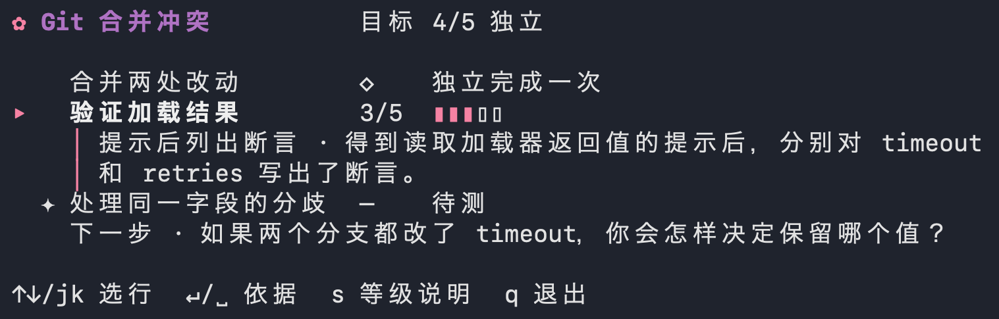
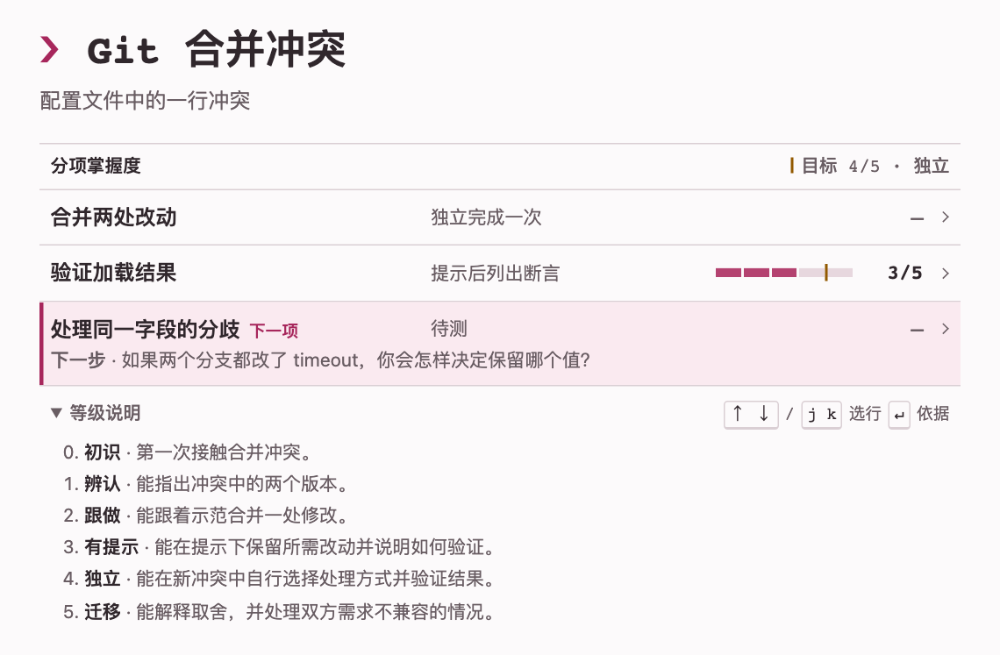

# Git 合并冲突练习

下面是一段模拟练习。两个分支改了同一行 JSON 配置，一个调整超时时间，另一个调整重试次数。

**辅导者**　原来是 `{"timeout": 10, "retries": 1}`。你的分支把 `timeout` 改成 30，另一个分支把 `retries` 改成 3。合并后这一行应该怎么写？

**学习者**　`{"timeout": 30, "retries": 3}`。

**辅导者**　两个改动都保留了。你会怎么确认程序用上了这两个值？

**学习者**　先检查 JSON 能不能解析。

**辅导者**　如果程序读的是旧配置，解析也可能成功。测试可以拿到配置加载器返回的 `config` 对象，你会检查它的哪两个值？

**学习者**　断言 `config.timeout == 30` 和 `config.retries == 3`。

## 终端里的评分依据

学习者自己合并对了一次，所以第一项记为「独立完成一次」。验证加载结果时，辅导者提示了检查哪个对象，因此第二项评为 3/5。选中它，按回车就能看到依据。

[](terminal.png)

## 网页里的等级说明

打开「等级说明」可以对照本次练习的六级标准。如果两个分支都改了同一个字段，该怎么取舍？这道题留到下一轮，因此第三项显示「待测」。

[](web.png)

两张图来自同一份[学习记录](session.json)。要在浏览器里试着展开各项依据，可以从[网页文件](report.html)的 GitHub 文件页下载原始文件，再双击打开。

## 试用

安装技能后，可以用一句话开始一轮新的练习。

> 用 $guided-practice 带我练 Git 合并冲突。我会看冲突标记，想练习怎么确认两边的改动都生效了。每次问我一题。

在本仓库根目录运行下面的命令，即可打开示例中的终端掌握图。

```sh
python3 skills/guided-practice/scripts/render_map.py examples/guided-practice/session.json
```

用 ↑/↓ 选知识点，回车展开依据，`s` 查看等级说明，`q` 退出。
