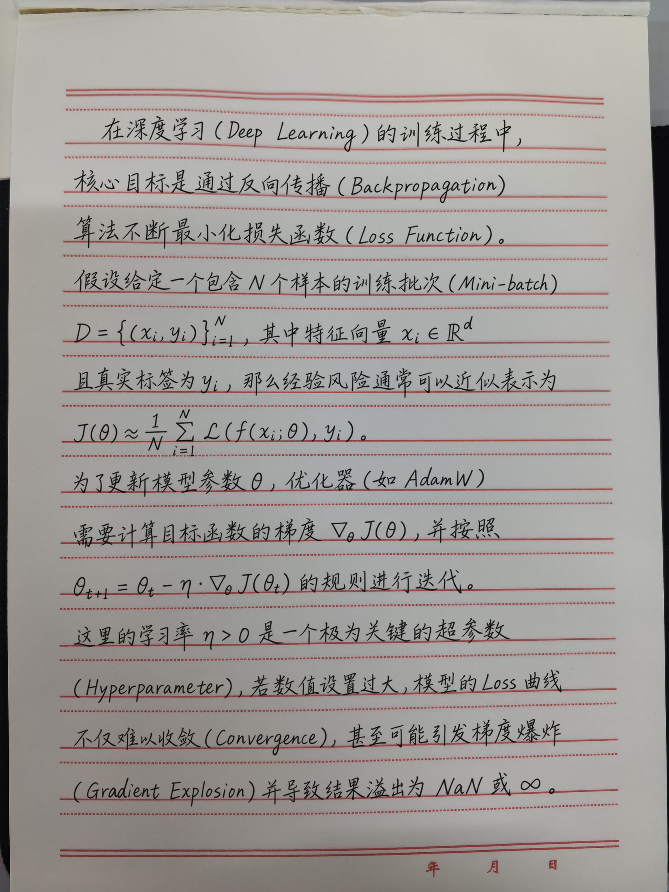
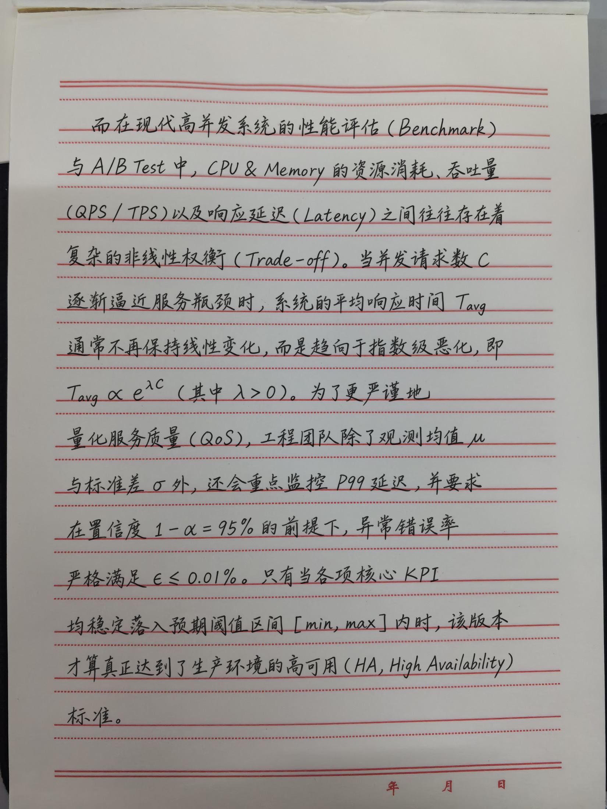
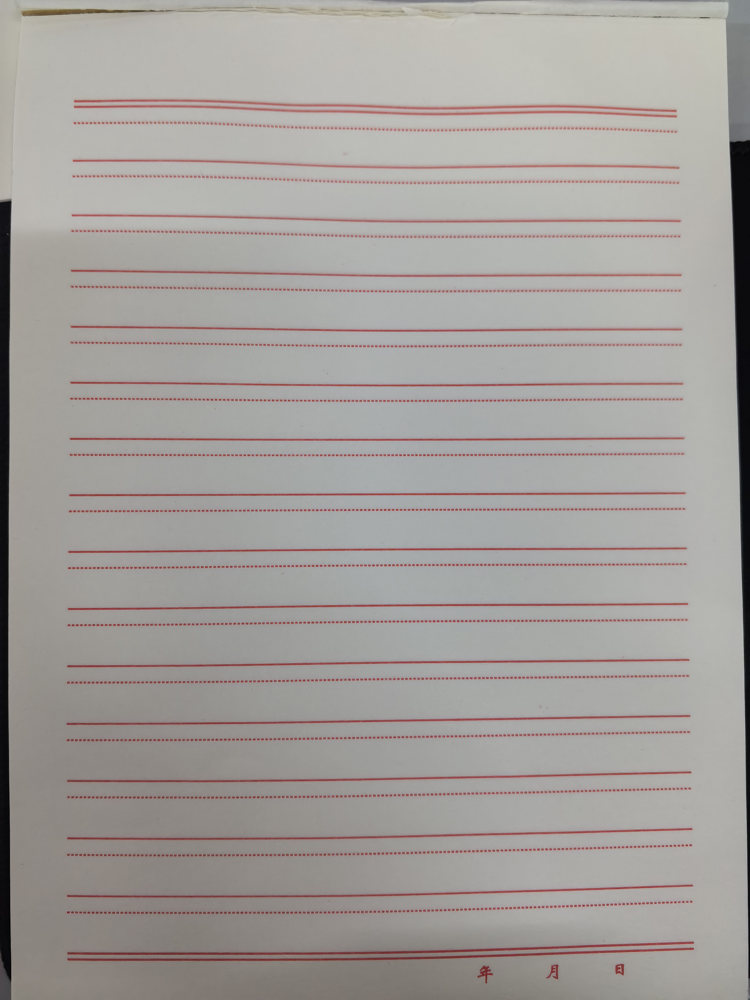
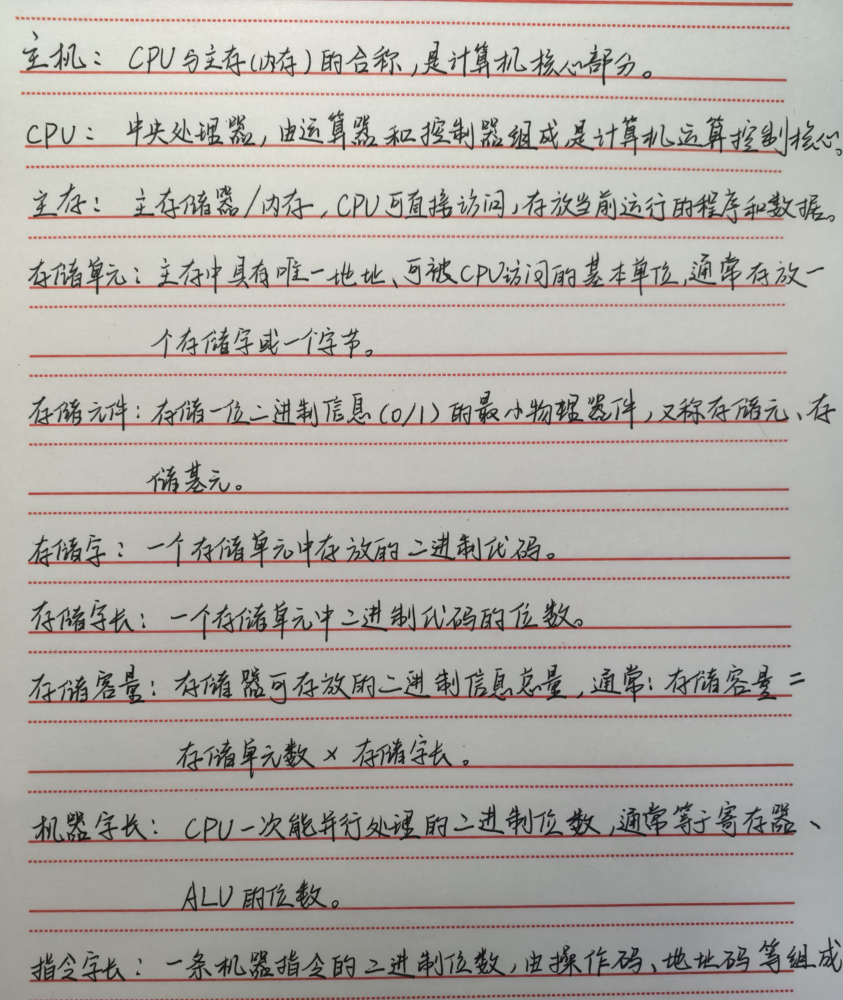

# 信纸上的手写笔记

两页笔记使用同一张红线信纸。第一页可以放大看求和式的上下标，第二页可以对照英文缩写、希腊字母和百分号。

| 深度学习与反向传播 | 高并发系统性能评估 |
| --- | --- |
| [](page-01.jpg) | [](page-02.jpg) |

## 纸张与笔迹

感谢同学贡献笔迹样稿。生成这两页时选用了右侧的中英混排样稿，参照中文与 CPU、ALU 等缩写之间的间距。合成时沿左侧信纸的红色实线放置墨迹，纸页的弯曲和光影都来自这张照片。

| 空白信纸 | 中英混排样稿 |
| --- | --- |
| [](../../skills/handwrite-page/assets/paper/red-ruled/photo.jpg) | [](../../skills/handwrite-page/assets/handwriting/mixed-definitions.jpg) |

其他三份样稿分别展示编号叙述、缩写对照和箭头流程。[查看全部笔迹参考](../../skills/handwrite-page/references/handwriting.md)

## 试用

```bash
npx skills add QwQBiG/skills --skill handwrite-page
```

在支持图像生成的 Codex 会话中粘贴正文，并附上这句要求。合成脚本需要 Python 和 Pillow。

> 用 $handwrite-page 把下面的正文写到默认信纸上，保留分段、大小写和公式。
